# Digitakt II Sample Editing Pack

Universal Zoom, SmartSlice, SampleLAB and native SLICE CFADE, for OS 1.17.
Hardware accepted by Kári on 2026-11-05; firmware hash is in the release README.
Screens are genuine 128×64 native emulator renders, enlarged without smoothing.
See [capture notes](CAPTURE_NOTES.md) for evidence and limitations.

## Four native UI demonstrations

These are edited native emulator captures, not hardware video. Holds are retimed
for reading; original pixels are preserved. See [capture notes](CAPTURE_NOTES.md).

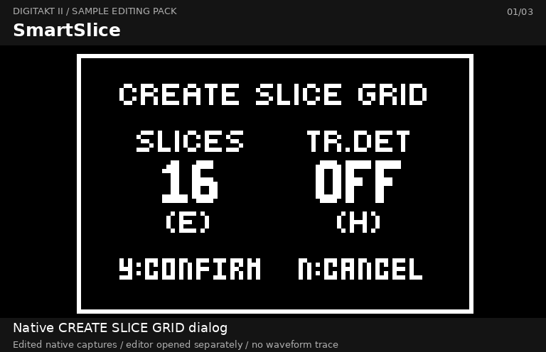

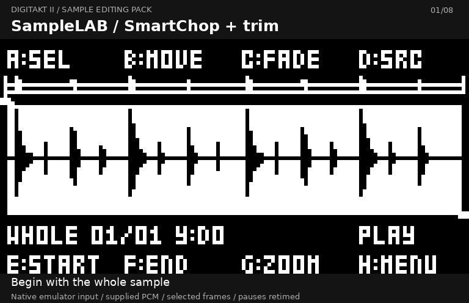

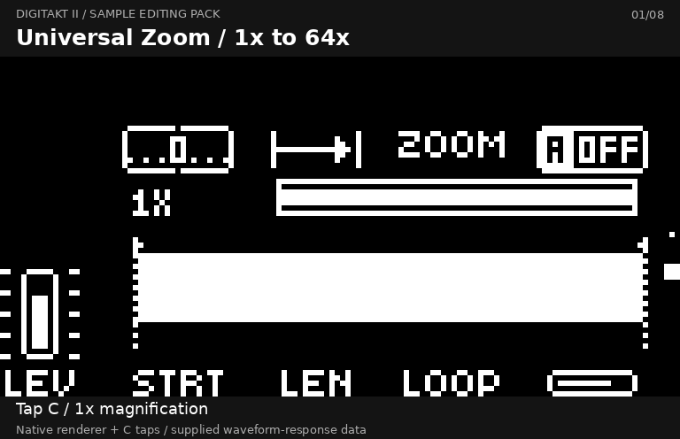

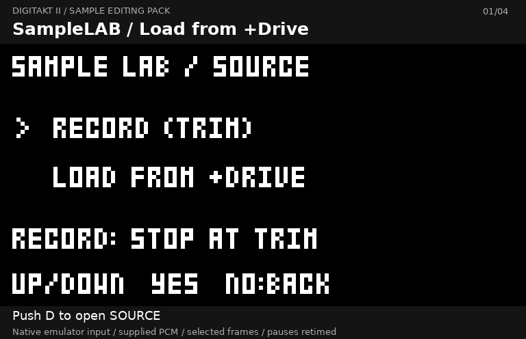

## Open SampleLAB and load a sample

From stopped recording TRIM, push **A** at **A:LAB**. **B:LOAD** on idle RECORD
or stopped TRIM opens the loading route. Normal recording and stock SAVE remain
available.

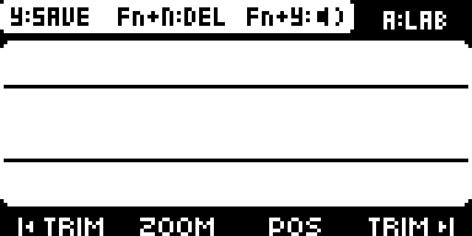

Inside SampleLAB, **push D** for SOURCE. Select **LOAD FROM +DRIVE** with
UP/DOWN, press YES, choose your folder/sample in the native browser, then YES
to load. The browser can resume its previous folder. Loading opens the whole
sample as **WHOLE 01/01**; it does not automatically assign a pool slot.

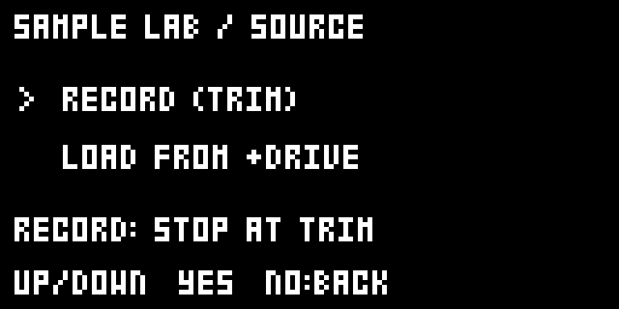
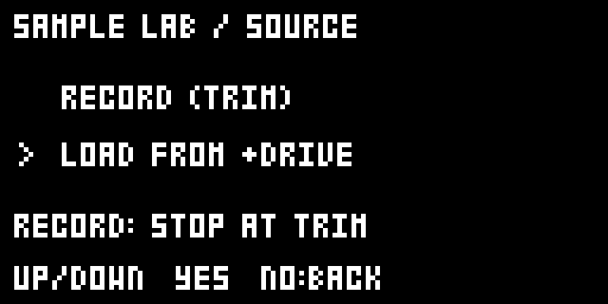
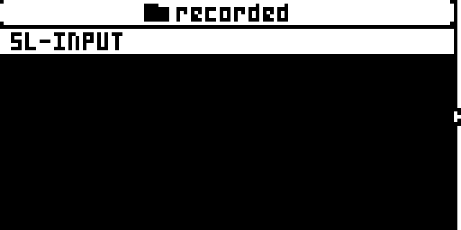
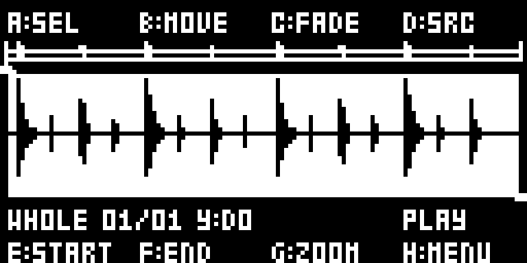

SOURCE also offers the existing recording source. Exported edits are copies;
keep the source for further editing.

## Waveform, Settings and Info

**Push H:** Waveform → Settings → Info → Waveform.
From Settings, H applies pending CHOP analysis before opening Info.
**NO from Settings or Info:** return to Waveform without applying pending
analysis. **NO from Waveform:** leave SampleLAB. Check the pending prompt:
YES performs analysis first when analysis is pending; otherwise it executes
the selected action. During a running operation follow its contextual
NO:CANCEL/NO:BACK prompt.

Settings uses four columns corresponding to physical A–D above and E–H below.
The underlined **YES** line tells you what confirmation will do. Info separates
PUSH shortcuts and navigation help from the editable settings.

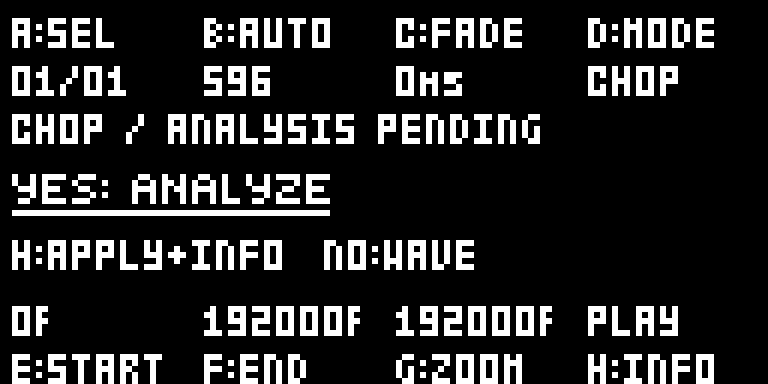
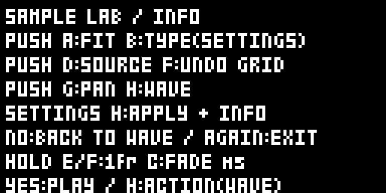

### CHOP controls

| Encoder | Turn | Push |
|---|---|---|
| A | Select region | Fit selected region |
| B | Waveform: move region. Settings: AUTO sensitivity or COUNT/EVEN target | Settings only: cycle AUTO → COUNT → EVEN |
| C | Editing/export FADE in milliseconds | No additional shortcut |
| D | Settings: CHOP/LOOP mode | Open SOURCE |
| E | START | No additional action; hold while turning for one frame per event |
| F | END | Restore previous marker layout; hold while turning for one frame per event |
| G | Zoom, or pan after pushing G | Toggle pan control |
| H | Waveform: select PLAY/SAVE/POOL/SAVE ALL/ALL POOL | Cycle pages; apply pending analysis when leaving Settings |

Info is read-only for encoder turns. A, D, F and G PUSH shortcuts retain their
existing functions. B TYPE is deliberately limited to Settings.

Turn A deliberately: selection advances one region after four directional
motion events, without accelerated multi-region skips. H uses two eligible
events per adjacent action and retains its existing time guard. Settings B is
finer: AUTO sensitivity advances per four delivered encoder units; COUNT/EVEN
per six. These are response policies, not promises of physical detent counts.
Changing direction clears partial selection gestures.

START/END follow the visible sample span. Deep zoom keeps the precise response;
zooming out allows faster travel. Faster turns still cover more distance using
the native encoder acceleration. The previous extra magnitude-based multiplier
is absent. Hold E/F while turning for one-frame adjustment per event; in LOOP
only E is START and F controls BPM. Boundaries remain constrained to valid
regions. The revised H response was accepted by Kári on hardware.

## SmartChop, trim and marker undo

Push H to Settings. Push B to choose AUTO, COUNT or EVEN and turn B to set its
value. AUTO detects regions; COUNT requests a target using detection/filling;
EVEN divides the range. Press **YES: ANALYZE**, or push H to apply pending
analysis and read Info. Push H again to return to the waveform.

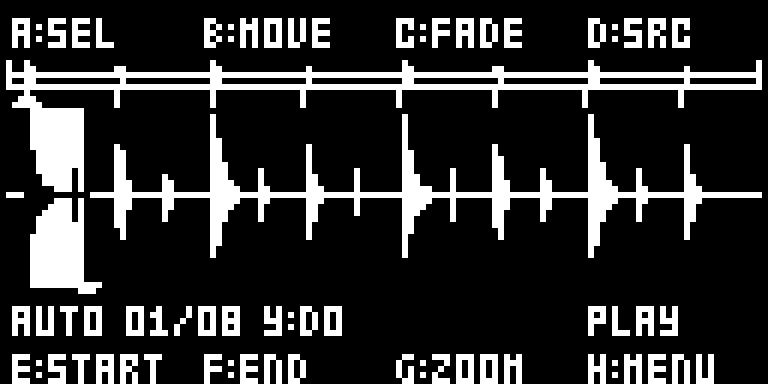

Turn A to choose a region, push A to fit it, then turn E and F to trim its
START and END. Turn B on the waveform to move the region; G controls zoom/pan.

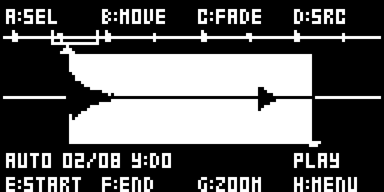
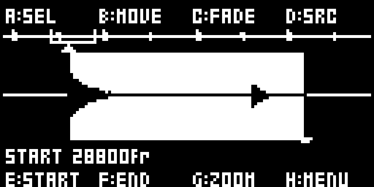
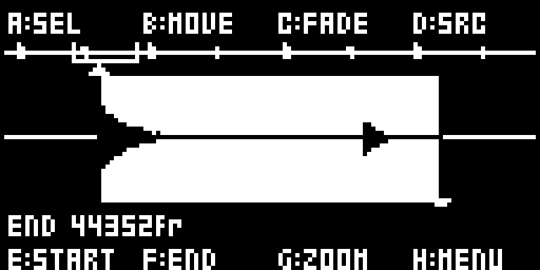

**Push F** for one-level marker-layout undo. It restores the backed-up grid,
including the whole-sample layout before analysis. It is not audio/file undo
and does not erase an exported file. If no backup exists, the screen says so.

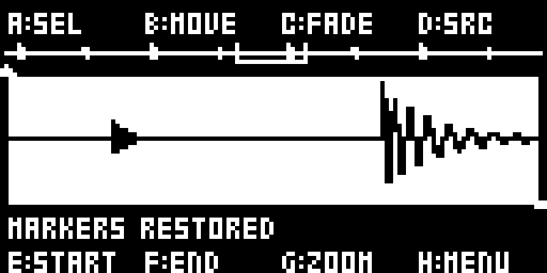

## LOOP editing

In Settings turn D to LOOP. B becomes fine movement, E remains START, F becomes
BPM and G in Settings becomes BEATS. On the waveform G retains zoom/pan.
Use the displayed BPM and beats to define the loop; confirm the intended range
before exporting. C FADE remains an editing/export edge blend, 0–50 ms.

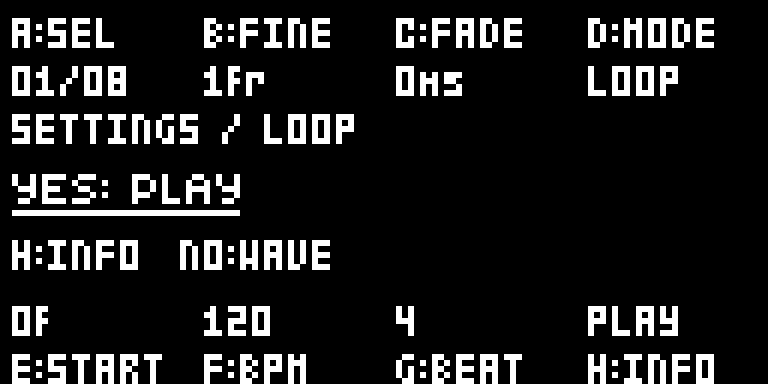
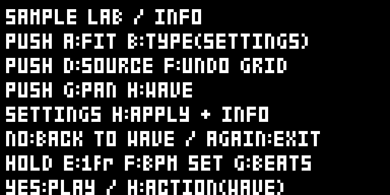

## Audition, save and assign

On the waveform, turn H deliberately to select an action. The current option
appears above H. Press YES once the prompt names the desired action; if it
instead says ANALYZE, that confirmation applies pending analysis first.

| Action | Result |
|---|---|
| PLAY | Audition the selected region |
| SAVE | Create a processed copy of the selected region |
| POOL | Export/assign the selected result to the project sample pool |
| SAVE ALL | Export all regions as separate copies |
| ALL POOL | Export all regions and assign them to the pool |

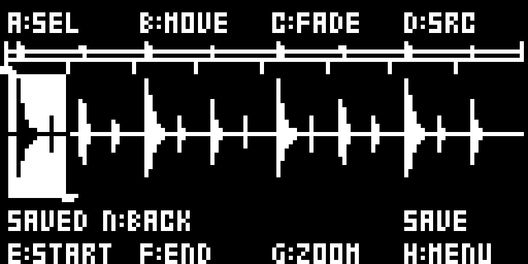

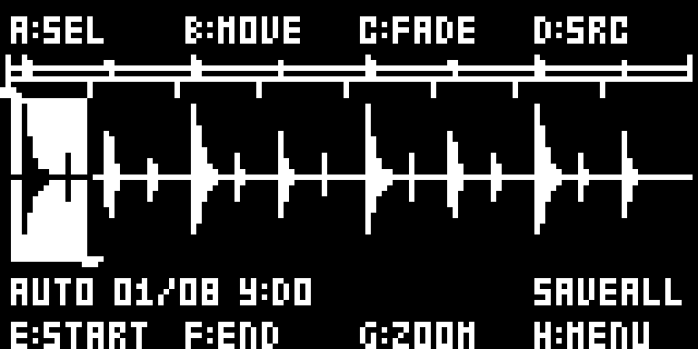

Wait for SAVED or IN POOL, or the batch progress/result. Original files are
preserved; export names avoid overwriting existing files. Pool capacity and
file errors are reported; a cancelled or failed batch can leave copies already
completed. Undo affects markers, not completed exports or pool assignments.
Save the project through the normal stock workflow when you want pool changes
to persist. No Sound/Project format extension is introduced by this pack.

## SmartSlice in the native SLICE machine

This is separate from SampleLAB analysis. Select SLICE. Open the stock slice
grid command to reach **CREATE SLICE GRID**. In that dialog the field is
**SLICES**, with encoder **E** underneath. Select **SMART** or a numeric grid,
then YES; NO cancels. Native LEN/LENGTH 64 and SampleLAB COUNT 64 are different
controls. Do not use SampleLAB COUNT to reproduce a native SLICE issue.

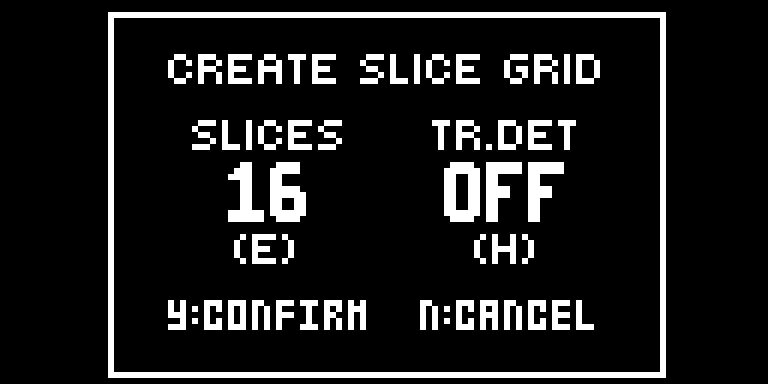
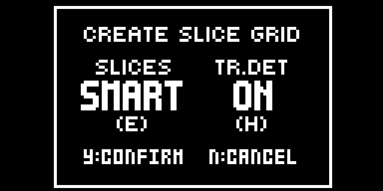
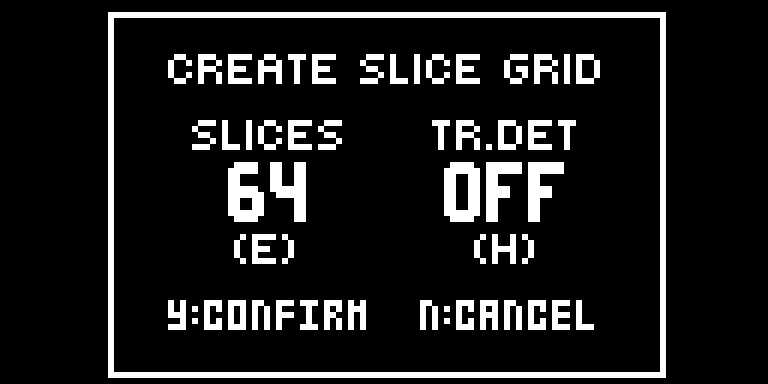

No full SRC menu-list screenshot is included; the capture set covers the
native dialogs and resulting markers. **EDIT SLICE POINTS** is opened
separately; SMART does not automatically open that editor. This verified example
produced 16 native boundaries. Detection count depends on the material. Native
START/ZOOM/POS/END in this editor remain stock controls.

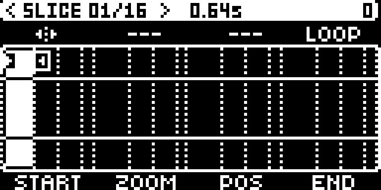

This CF-only marker capture has no DSP waveform trace. The grid and count come
from the real SMART result. The SmartSlice owner/overflow exception fixes are
included. For future regression checks, repeat native LENGTH 64 requests after weak/failed
detection, including sparse and very short samples.

## Universal Zoom

On ordinary sample-machine SRC pages **tap C** through 1×, 2×, 4×, 8×, 16×,
32× and 64×; the next tap returns to 1×. Turn C to pan while zoomed, hold C to
reset. On **SLICE use G** for the same functions because C remains CFADE.
The duplicate number above ZOOM is removed; the other zoom indicator remains.
SampleLAB and EDIT SLICE POINTS use their own controls described above.

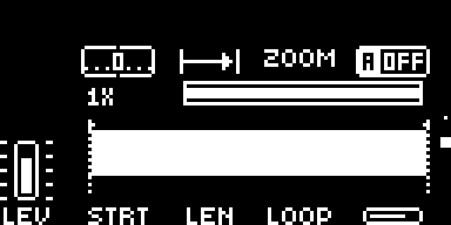
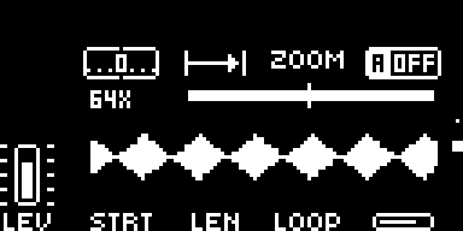

## SLICE playback CFADE

CFADE is included. On SLICE SRC **turn C** for playback loop-wrap blending,
0/OFF through 127. G retains Universal Zoom. This is not a cross-slice
transition engine. SampleLAB C:FADE in milliseconds is a separate destructive
processing step applied to an exported copy, not this playback parameter.

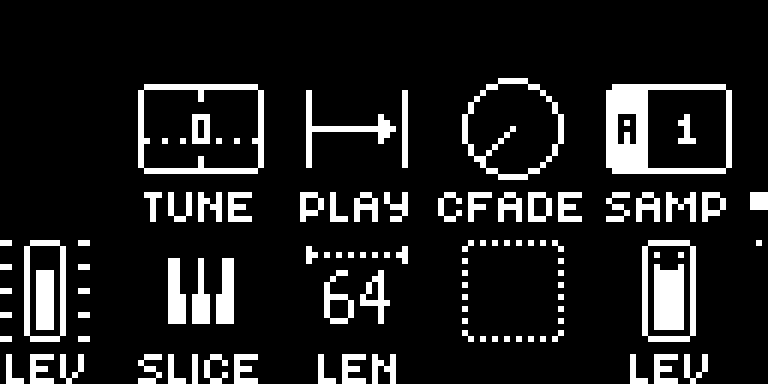
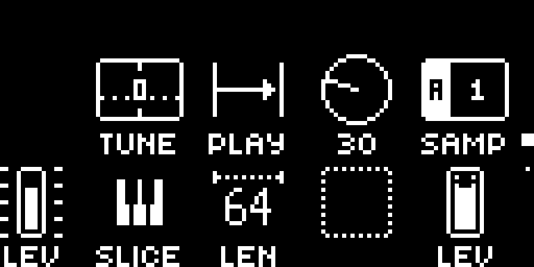

Keep normal sample loading, stock editing/saving and project backup practices.
The builder produces a local file only; it never flashes or connects to a device.
